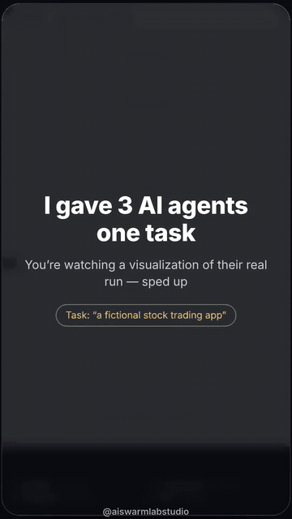

# AI Swarm Builder — a team of AI agents builds a web page, and every step is measured

A small team of AI agents builds a web page on screen while a code-based builder measures the result: real text contrast, and whether the content fits its box. A QA agent reads those measurements, and failed checks send the work back to the copywriter or the designer. The whole session is recorded as JSON, can be replayed with no model calls, and can be rendered to a vertical video with sound.

> Status: working project, used to produce short videos. [TikTok: @aiswarmlabstudio](https://www.tiktok.com/@aiswarmlabstudio)



*A recording of a real run for the task "a fictional stock trading app", sped up. The coloured cursors are the agents; the green marks at the end are the Builder's measurements (contrast ratios and "fits").*

## The roles

| Role | What it is |
|---|---|
| Copywriter | a model call that writes the page text |
| Designer | a model call that chooses the colour palette |
| Builder | plain code, no model: assembles the page step by step and measures contrast and fit |
| QA | a model call that reads the measurements and returns a verdict, a short message and the issues, each assigned to the copywriter or the designer |

**The loop.** Copywriter and Designer work in parallel. The Builder assembles the page and measures every text element. QA reviews the numbers. If any check fails, contrast problems go back to the Designer and everything else to the Copywriter, and the Builder rebuilds. After three rounds, code applies a contrast fix itself and the recording says so ("auto-fix applied by code, not by a model"); anything still failing is listed as unresolved.

Whether the work goes back is decided by the measurements, not by the QA model's mood; the QA call explains and assigns the problems. Every call is stored with its prompt, its response and the numbers measured, so the video shows a real test and not a script.

## Page types

Each page type is one object in `TYPES` with its slots, build steps, readability checks and agent prompts. The engine (cursors, roles, loop, sound, recording) is shared, so a new type is one object plus its CSS.

| Type | What it builds |
|---|---|
| `landing` | navigation, hero, three product cards with prices, footer |
| `blog` | navigation, featured post, three post rows, subscribe block |
| `news` | masthead, breaking ticker, lead story, three numbered headlines, footer (stories are invented; the prompt forbids real people, organisations and events) |

## Two modes

**Live agents.** Copywriter, Designer and QA are separate model calls made through the sampling capability of the Claude artifact runtime (`claude.use('sample')`). There is no API key in the code. The live panel appears only when the page runs as a Claude artifact; the model calls then count against your own Claude usage.

**Replay and render.** Opened as a plain file, the page works without any model: it plays a built-in sample build, the sample plans in `plans/`, or a recording you load. No model calls.

## Workflow

1. Run live agents in the artifact: choose language, topic and page type.
2. Copy or download the recording (JSON) and save it in `traces/`.
3. Render a video, with no new model calls:

```bash
npm install
node render.mjs traces/my-run.json --speed 2
```

Needs Node 18+, ffmpeg in PATH, and Chrome or `npx playwright install chromium`. Output: `out/my-run.mp4`, 1080x1920. `node render.mjs --all` renders everything in `traces/` and `plans/`.

## Video options

- Sound effects are synthesised in the page with WebAudio, so there are no audio files and no copyright issues. Options: `--no-sound`, `--sfx-volume`, `--sync`, and `--music file.mp3 --music-volume 0.15` (only for music you have the rights to).
- Square 1080x1080 variant with a watermark: `--square --watermark "Your name"`.
- The hook at the start and the question at the end are built from the recording itself: the number of agents and the number of QA rounds are the real ones. Disable with `--no-hook`.

## Honesty note

A plan that was not produced by a live agent test gets no "real agents" hook. A recording is presented as an agent session only if it is one.

## Notes

- The page is a single HTML file. The control panel follows the browser language (Bulgarian or English; force it with `?ui=en` or `?ui=bg`). The text inside the build and the video is chosen separately (`?lang=en|bg`, or `--lang` in `render.mjs`). The built-in sample sites and the code comments are in Bulgarian.
- Stack: JavaScript (single-file page), Node.js renderer with Playwright and ffmpeg.

## Author

Dean Bouzekow — [LinkedIn](https://www.linkedin.com/in/dean-b-513b24162/)
